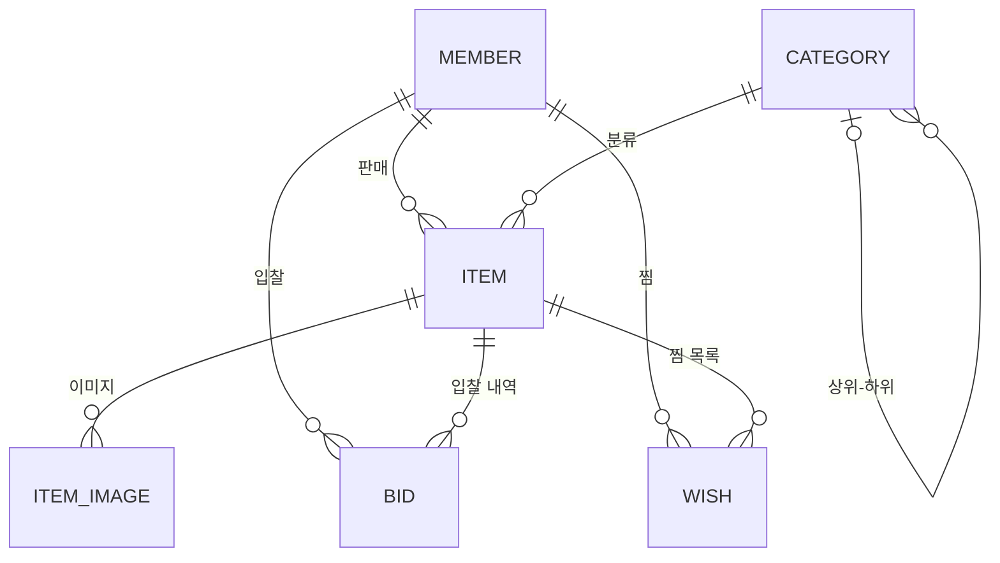

# 땅땅 (Dangdang) - 중고 경매 플랫폼

Spring Data JPA + Hibernate + QueryDSL 학습용 경매 서비스

## 기술 스택
- Java 21, Spring Boot 4.1, Spring Data JPA (Hibernate 7)
- QueryDSL 7 (OpenFeign fork)
- MySQL 8.4 (Docker Compose), Testcontainers

## 실행
```bash
# Docker Desktop 실행 후
./gradlew bootRun      # compose.yaml 의 MySQL 이 자동으로 뜸 (localhost:3307, dangdang/dangdang)
./gradlew test         # Testcontainers 로 테스트 전용 MySQL 이 뜸
```

## 도메인



| 엔티티 | 설명 | 주요 연관관계 |
|---|---|---|
| `Member` | 회원 (판매자/입찰자) | |
| `Category` | 상품 카테고리 (디지털 > 노트북 > 맥북) | 자기 자신을 부모로 참조 (self 참조) |
| `Item` | 경매 상품 | `Member`(판매자) N:1, `Category` N:1 |
| `ItemImage` | 상품 이미지 | `Item` N:1, 상품 삭제 시 함께 삭제 (cascade + orphanRemoval) |
| `Bid` | 입찰 내역 | `Item` N:1, `Member`(입찰자) N:1 |
| `Wish` | 찜 | `Member` ↔ `Item` 의 N:M 을 풀어낸 중간 엔티티 |

## 학습 로드맵
- [x] 엔티티 / 연관관계 매핑
- [ ] N+1 해결 (fetch join, EntityGraph, batch size) — `ItemNPlusOneTest`
- [ ] QueryDSL 동적 검색 (하위 카테고리 포함), DTO Projection, 통계
- [ ] 동시 입찰 제어 (비관적/낙관적 락), 마감 경매 벌크 처리

## 트러블슈팅 기록
<!-- 개선 전/후 쿼리 수, 응답 시간 등을 숫자로 기록 -->
