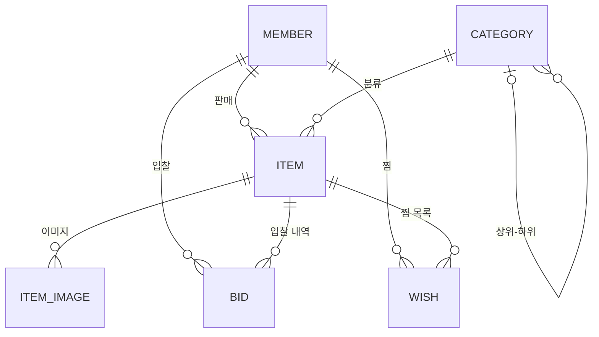

# 땅땅 (Dangdang) - 중고 경매 플랫폼

Spring Data JPA + Hibernate + QueryDSL 학습용 경매 서비스

## 기술 스택
- Java 21, Spring Boot 4.1, Spring Data JPA (Hibernate 7)
- QueryDSL 7 (OpenFeign fork)
- MySQL 8.4 (Docker Compose), Testcontainers

## 실행
```bash
# Docker Desktop 실행 후
./gradlew bootRun      # compose.yaml 의 MySQL 이 자동으로 뜸 (localhost:3307, dangdang/dangdang)
./gradlew test         # Testcontainers 로 테스트 전용 MySQL 이 뜸
```

## 도메인



| 엔티티 | 설명 | 주요 연관관계 |
|---|---|---|
| `Member` | 회원 (판매자/입찰자) | |
| `Category` | 상품 카테고리 (디지털 > 노트북 > 맥북) | 자기 자신을 부모로 참조 (self 참조) |
| `Item` | 경매 상품 | `Member`(판매자) N:1, `Category` N:1 |
| `ItemImage` | 상품 이미지 | `Item` N:1, 상품 삭제 시 함께 삭제 (cascade + orphanRemoval) |
| `Bid` | 입찰 내역 | `Item` N:1, `Member`(입찰자) N:1 |
| `Wish` | 찜 | `Member` ↔ `Item` 의 N:M 을 풀어낸 중간 엔티티 |

## 학습 로드맵
- [x] 엔티티 / 연관관계 매핑
- [x] N+1 해결 (fetch join, batch size) — `ItemNPlusOneTest`, `ItemBatchFetchTest`
- [ ] QueryDSL 동적 검색 (하위 카테고리 포함), DTO Projection, 통계
- [ ] 동시 입찰 제어 (비관적/낙관적 락), 마감 경매 벌크 처리 — **다음 1순위** (면접 "낙관적·비관적 락" 질문에 실험 결과로 답하기 위함)
- [ ] 모니터링: Actuator + Prometheus + Grafana 를 Docker Compose 로 붙이기 (면접 "모니터링 도구" 질문 보강)
- [ ] 무중단 배포: 컨테이너 2개(또는 EC2 2대) + Nginx 로 롤링 배포, 헬스체크·graceful shutdown 확인 (면접 "무중단 배포" 질문 보강)

## 트러블슈팅 기록
<!-- 개선 전/후 쿼리 수, 응답 시간 등을 숫자로 기록 -->

### N+1 (상품 목록: 판매자 N:1, 이미지·입찰 1:N)

| 상황 | 방법 | 쿼리 수 | 테스트 |
|---|---|---|---|
| 상품 10개, 판매자+이미지 | 지연 로딩 그대로 | 21 | `ItemNPlusOneTest` |
| 〃 | fetch join | 1 | `ItemNPlusOneTest` |
| 컬렉션 fetch join + 페이징 | Hibernate 7 은 서브쿼리로 상품만 먼저 `limit` (5/6 은 메모리 페이징 + HHH90003004 경고) | 1 | `ItemNPlusOneTest` |
| 컬렉션 2개(images, bids) 동시 fetch join | `MultipleBagFetchException` 발생 | - | `ItemBatchFetchTest` |
| 상품 10개, 판매자+이미지+입찰 | `default_batch_fetch_size=100` | 31 → 4 | `ItemBatchFetchTest` |
| 상품 150개 (batch size 초과) | 〃 | 451 → 7 (in 쿼리가 100 + 50 으로 나뉨) | `ItemBatchFetchTest` |
| 페이징 (5건) | 판매자만 fetch join + 컬렉션은 batch size | 4 (본문 `limit` + count + 이미지 + 입찰) | `ItemBatchFetchTest` |

**정리**
- N:1 은 fetch join (행이 늘지 않아 페이징 안전), 1:N 컬렉션은 batch size 가 기본 조합
- batch size 를 넘으면 쿼리가 `ceil(N / batch size)` 번으로 나뉨
- Hibernate 6+ 는 in 절의 `?` 개수를 항상 batch size 로 고정하고 남는 자리는 null 로 채움 (50개 조회도 `?` 100개). SQL 이 한 가지라 PreparedStatement 캐시를 재사용하려는 것
